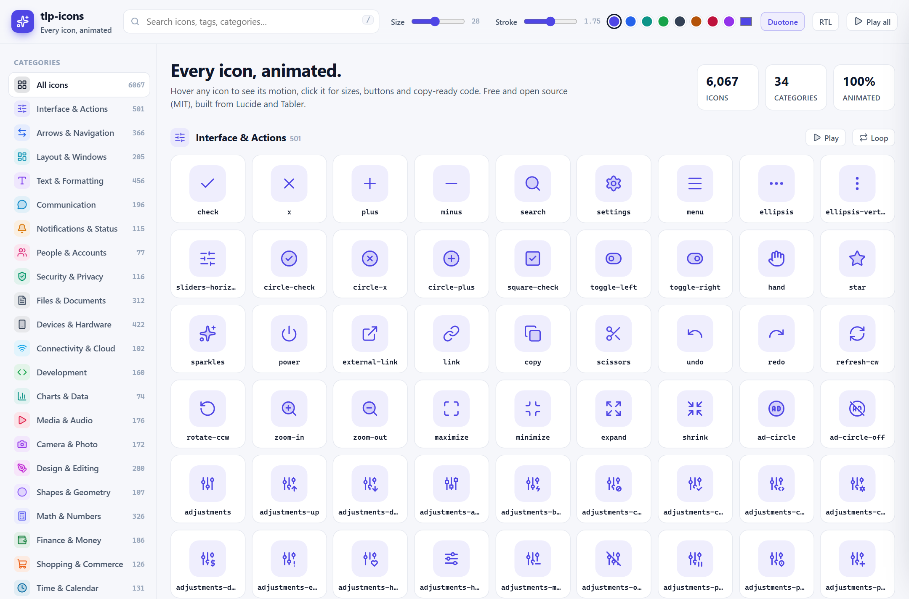
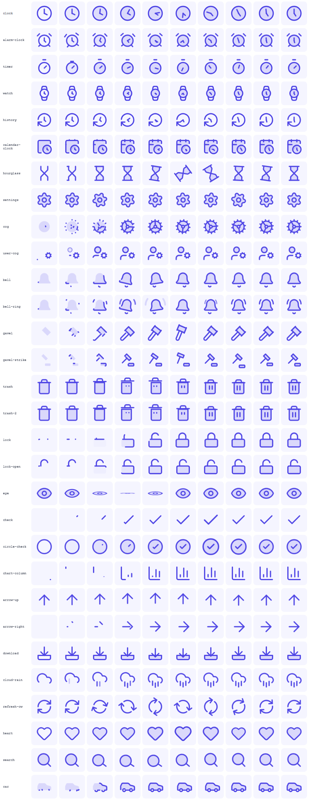

<p align="center">
  <a href="https://tlp-icons.netlify.app"></a>
</p>

<h1 align="center">tlp-icons</h1>

<p align="center">
  <b>Every icon, animated.</b><br>
  <a href="https://tlp-icons.netlify.app/icons/"><b>Browse the icons</b></a> ·
  <a href="https://tlp-icons.netlify.app/docs/"><b>Documentation</b></a> ·
  <a href="https://tlp-icons.netlify.app/categories/brands/">Brands</a> ·
  <a href="ROADMAP.md">Roadmap</a> ·
  <a href="https://github.com/Tamer-Mansour/tlp-icons">GitHub</a>
</p>

<p align="center">
  
  
  
  
</p>

A free, open-source (MIT) library of 6,489 stroke icons, built from the best free sets (Lucide and Tabler) plus
our own **tlp originals**, sorted into 35 hand-curated categories, including **376 brand logos** (Facebook,
Instagram, WhatsApp, X, TikTok, YouTube...). Every single one moves on hover: clock hands sweep around the face,
gears spin on their axle, bells swing from the top, trash lids lift, arrows move the way they point.

[](https://tlp-icons.netlify.app)

<details>
<summary>Motion frames (each row is one hover animation frozen at 10 points)</summary>


</details>

- **6,489 icons**: 24×24 grid, 2px stroke, round caps, `currentColor`. One consistent style.
- **100% animated**: 300+ hand-made choreographies, plus a motion engine that reads each icon's geometry.
- **Deep fields**: we draw our own icons where the free sets stop. Legal went from 18 to 59 first; the
  [roadmap](ROADMAP.md) takes it to 1,180 and the whole library to 26,000.
- **Brand logos**: 376 brands in the same outline style, animated (trademarks of their owners, see `NOTICE.md`).
- **Tiny runtime**: one custom element, `<tlp-icon>`. Works in plain HTML, React, Angular, Vue, Svelte...
- **Lazy**: icons load per category, so a page that uses 10 icons doesn't download 6,000.
- **Polite motion**: plays once to the end, never animates a whole card at once, respects `prefers-reduced-motion`.
- **Works offline**: the gallery opens straight from disk, and the build never needs the network.

## Install

```bash
npm install tlp-icons
```

Or with no build step, from a CDN:

```html
<script type="module" src="https://unpkg.com/tlp-icons/dist/tlp-icon.js"></script>
<tlp-icon name="bell"></tlp-icon>
```

Offline / no modules (for example opened from `file://`): one classic script with every icon inside (about 2.2 MB):

```html
<script src="node_modules/tlp-icons/dist/tlp-icons.all.js"></script>
<tlp-icon name="bell"></tlp-icon>
```

## Usage

```html
<tlp-icon name="bell"></tlp-icon>
<tlp-icon name="settings" size="32" stroke="1.5"></tlp-icon>
<tlp-icon name="loader-circle" trigger="loop"></tlp-icon>
<tlp-icon name="heart" trigger="click" duotone></tlp-icon>
<tlp-icon name="arrow-right" flip="rtl"></tlp-icon>
```

| Attribute | Values | Default |
| --- | --- | --- |
| `name` | any icon name (or a Lucide alias) | |
| `size` | number (px) or any CSS length | `24` (or `--tlp-size`) |
| `stroke` | stroke width | `2` (or `--tlp-stroke`) |
| `trigger` | `hover`, `loop`, `click`, `none` | `hover` |
| `duotone` | boolean, adds a soft tinted body fill | off |
| `flip` | `rtl` (mirror only in right-to-left pages), `x` (always mirror) | off |

The icon takes its color from `color`, like text. Theme everything with CSS variables:

```css
tlp-icon { --tlp-size: 20px; --tlp-stroke: 1.75; }
.card { --tlp-duo: .2; } /* duotone strength */
```

Play it from code: `document.querySelector('tlp-icon').play()`.

**Hover rule.** Hovering an icon animates it. Hovering anything else walks up to the nearest element that holds
exactly one icon (a button, a menu item) and animates that icon. If it reaches an element with several icons first
(a card, a menu, a table row), nothing animates. So hovering a button animates its icon, while a big card never
lights up all its icons at once.

### React

```jsx
import 'tlp-icons/element';

export function SaveButton() {
  return <button><tlp-icon name="save" /> Save</button>;
}
```

React 19 supports custom elements directly. For TypeScript JSX, declare `tlp-icon` in `JSX.IntrinsicElements`.

### Angular

```ts
// main.ts
import 'tlp-icons/element';

// component
@Component({ schemas: [CUSTOM_ELEMENTS_SCHEMA], template: `<tlp-icon name="bell"></tlp-icon>` })
```

### Vue

```ts
// main.ts
import 'tlp-icons/element';
// vite.config.ts -> vue({ template: { compilerOptions: { isCustomElement: tag => tag === 'tlp-icon' } } })
```

```html
<tlp-icon name="bell" />
```

### Raw data and SVG strings (Node / SSR)

```js
import { icons, categories, getSvg } from 'tlp-icons';

getSvg('bell');                                // static SVG markup
getSvg('bell', { size: 32, stroke: 1.5 });
getSvg('bell', { animated: true });            // SVG with the motion baked in (needs dist/tlp-icons.css)
icons.bell;                                    // { svg, m: [[part, anim, dur, delay, origin?], ...] }
```

Importing `icons` pulls in the whole set. For pages, use `<tlp-icon>`, which loads one category chunk at a time.

## Website

**https://tlp-icons.netlify.app** is built with **Next.js (React)** in `web/` and uses this package itself
(`"tlp-icons": "file:.."`). Every page is pre-rendered static HTML for search engines:

| Page | URL |
| --- | --- |
| Home | `/` |
| Icon gallery (search, filters, size / stroke / color / duotone) | `/icons/` |
| One page per icon: preview, sizes, buttons, code for React / HTML / Angular / Vue / SVG, related icons | `/icons/<name>/` (6,489 pages) |
| Categories, one page each, including Brands | `/categories/`, `/categories/<id>/` |
| Documentation with live examples and the animation library | `/docs/` |
| Roadmap with live progress | `/roadmap/` |
| `sitemap.xml`, `robots.txt`, Open Graph image | |

```bash
npm run build                  # the library (repository root)
cd web && npm install
npm run dev                    # http://localhost:3000
npm run build                  # static site in web/out (about 270 MB, 6,700 files)
node scripts/serve.mjs         # serve web/out on http://localhost:4321
```

Netlify runs the same steps (see `netlify.toml`) and publishes `web/out` on every push to `main`.

**Offline gallery:** `site/index.html` is a single-page version that opens straight from disk, with no server
and no internet.

## How it works

```
npm run sync    online:  latest Lucide + Tabler -> normalised snapshot in upstream/ -> build
npm run build   offline: upstream/ + config/ + overrides/ -> dist/ (library) + site/ (gallery)
npm test        offline: node:test suite (data, motion, keyframes, build idempotency)
npm run test:browser   optional Playwright tests + frame strips (npm run setup:browser once)
```

- `config/sources.json`: upstream versions (written by sync). Brand logos are off.
- `config/categories.json`: the taxonomy, plus explicit mapping tables for every upstream category, name patterns
  and the featured order.
- `config/rules.json`: keyword → motion recipe. Data, not code.
- `overrides/<name>.json`: hand choreographies. These always win over the engine.
- `originals/<name>.json`: **tlp originals**, icons we draw ourselves (with their category, tags and motion).
- `config/roadmap.json`: per-category goals and planned icon lists → `ROADMAP.md` (`node scripts/roadmap.mjs`)
  and the `/roadmap/` page.
- `scripts/adapters/`: one adapter per icon source (`latest`, `fetch`, `load`). Add a set by adding an adapter.
- `scripts/engine/`: SVG parsing, geometry, the motion engine and serialisation.
- `src/runtime/`: `core.js` (registry, baking, run engine, hover rule), `element.js` (`<tlp-icon>`) and
  `tlp-icons.css` (the 34 `tlp-` keyframes).

**Motion engine.** Every icon is split into atoms (one per element or sub-path) and measured. Then:

1. **Hand override**, if there is one.
2. **Mechanics detectors.** Clocks: find the face and split the hands at its centre, then sweep the minute hand
   and advance the hour hand (it keeps its position between hovers). Gears spin on their axle, and several gears
   turn opposite ways. Arrows: find each arrow head and its shaft, then move them the way they point.
3. **Composites**: `file-plus`, `user-cog` and `circle-check` animate as base + badge, or container + glyph.
   `-off` icons draw their slash last.
4. **Keyword rules** from `config/rules.json`: bells swing, trash lids lift, locks open on their hinge, eyes
   blink, charts grow, rain falls, vehicles drive...
5. **Fallback**: a duotone body fills in, the outline draws, details follow, then a soft finishing gesture.
   The gesture varies so neighbouring icons don't all look the same.

Every motion is small and springy and ends exactly at rest. The default `speed` is 0.6, which averages about
0.9 s per icon (1.56 s max). Change it with `import { config } from 'tlp-icons/element'; config.speed = 0.8`.

## Contributing

- New icon: add `originals/<name>.json` (24×24, 2px stroke, round caps, parts `p1`..`p4`, `motion` steps).
  Pick one from the planned lists in [ROADMAP.md](ROADMAP.md). Check it with
  `node scripts/sheet.mjs review <name>` and `node scripts/strips.mjs review <name>` (images in `test/browser/shots/`).
- Better motion for one icon: add `overrides/<name>.json` with the SVG retagged into parts (`class="p1"`...)
  and its `motion` steps. See any existing override.
- Better motion for many icons: add or adjust a rule in `config/rules.json`.
- Wrong category: add a name pattern or an explicit entry in `config/categories.json`.
- Run `npm run build && npm test` before opening a PR.

The GitHub Actions (CI and upstream sync) are manual: run them from the Actions tab when needed.

## License

MIT © tlp-icons contributors. Icon geometry from [Lucide](https://lucide.dev) (ISC) and
[Tabler Icons](https://tabler.io/icons) (MIT), plus tlp originals (MIT). See [NOTICE.md](NOTICE.md) and `licenses/`.

Brand logos are trademarks of their respective owners and are included only to identify their products.
